# Dakon

Congklak between two wallets, refereed move by move on BOT Chain.

One player opens a table and picks the board and the pace. Another sits down and moves first. Every move is a transaction, and the contract plays the whole sowing itself: the relay when the last seed lands on seeds, the extra turn when it lands in your store, the capture when it lands in an empty hole on your side. No illegal move gets through, every finished game can be replayed seed by seed, and nothing is wagered.

*Dakon* is the Javanese name for congklak.

- Product scope and decisions: [PRD.md](PRD.md) · status: [PROGRESS.md](PROGRESS.md)
- Network: BOT Chain Mainnet, chain ID 677 — <https://botchain.ai> · <https://scan.botchain.ai>


## Screenshots

Taken from the local chain with the sample tables that `npm run seed:local` creates. For the table shots, dev wallet Tari also took the seat reserved for her at table 10 and played a few moves against Sekar.

### Playing

| A move to make | Sowing, seed by seed |
|---|---|
|  | 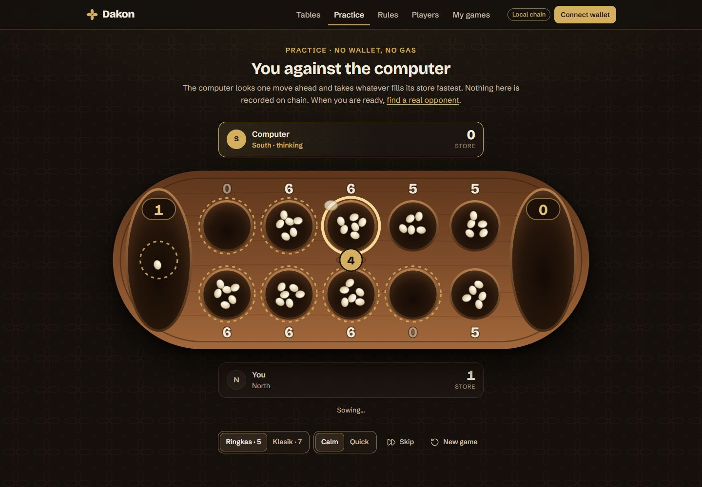 |

### Finding a game

| The lobby | Opening a table |
|---|---|
| 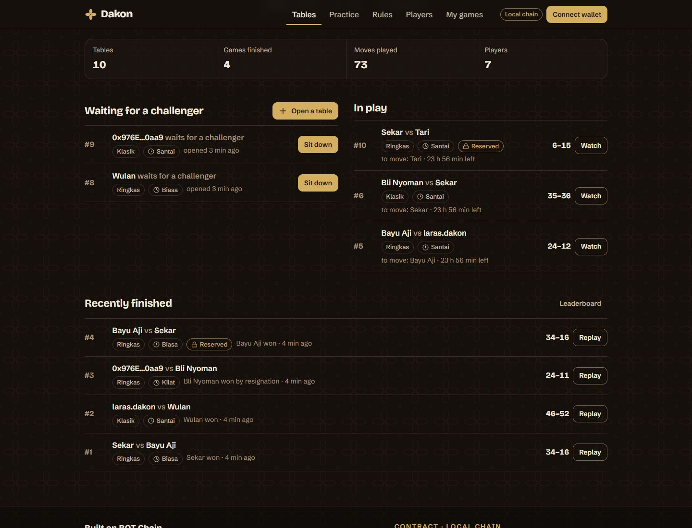 | 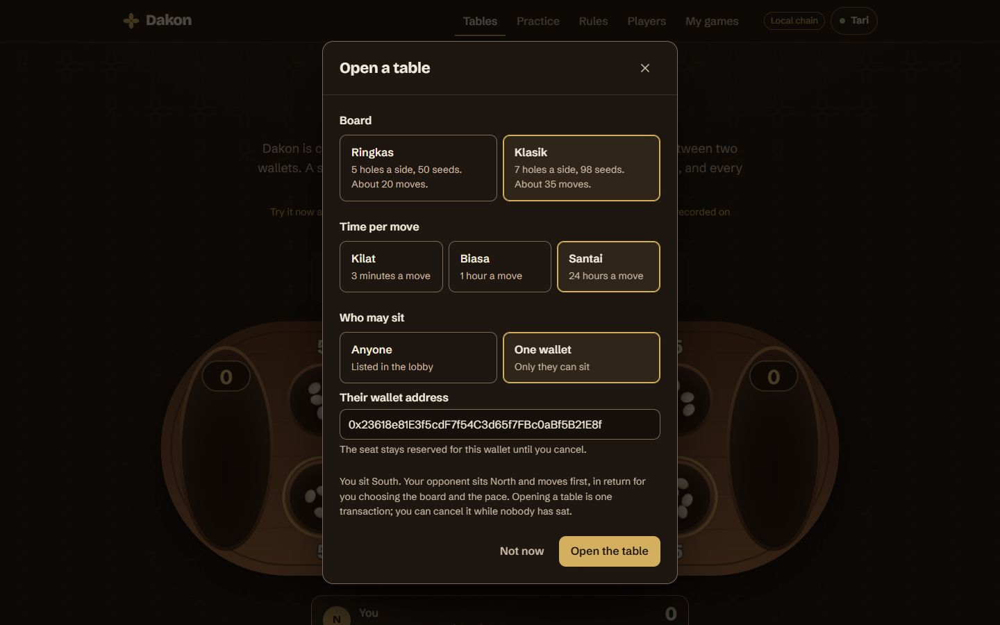 |

### After the game

| Replay | Leaderboard |
|---|---|
| 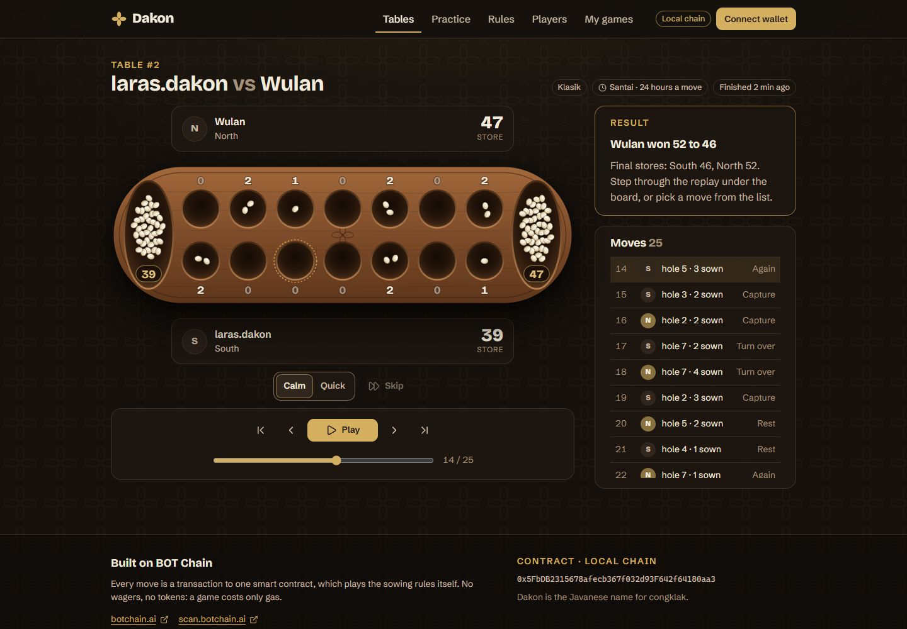 | 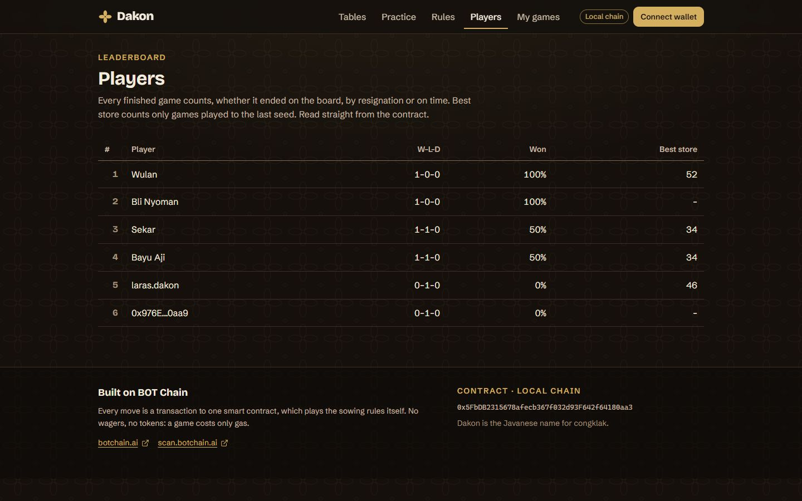 |

### Learning the game and keeping track

| Rules | My games |
|---|---|
| 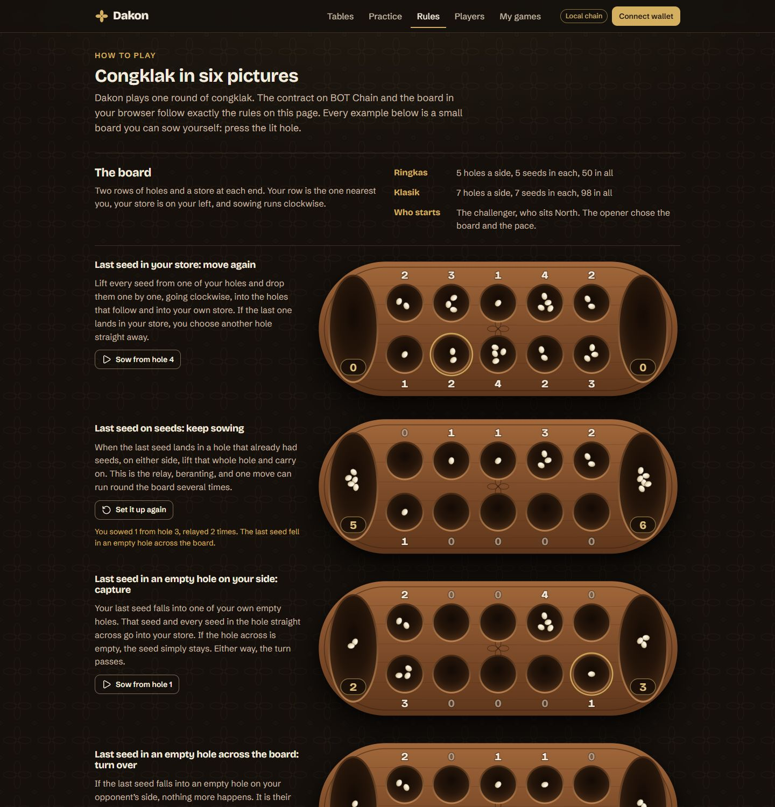 | 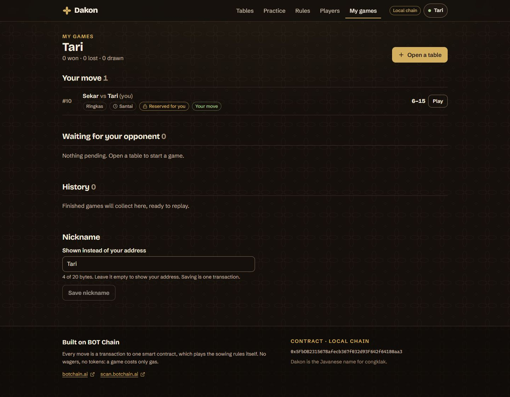 |

### Phone and tablet

| A table at 375 px | Sowing at 375 px |
|---|---|
| 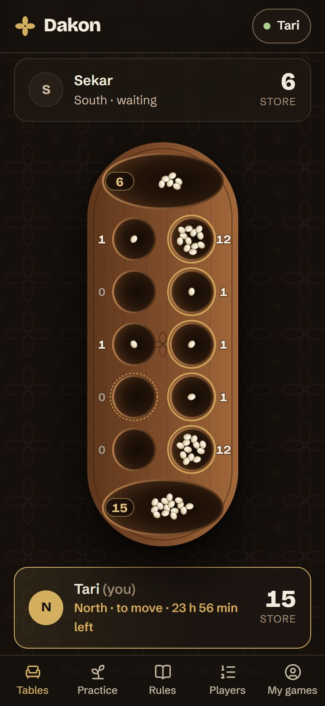 | 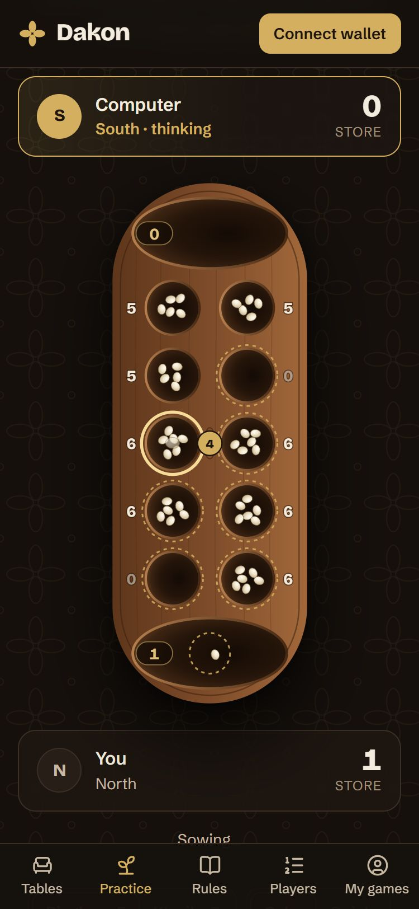 |

| My games at 375 px | A Klasik table at 768 px |
|---|---|
| 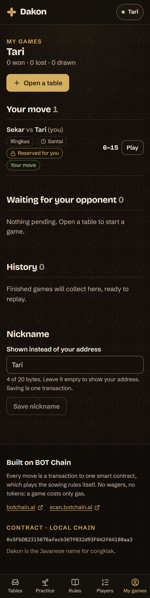 | 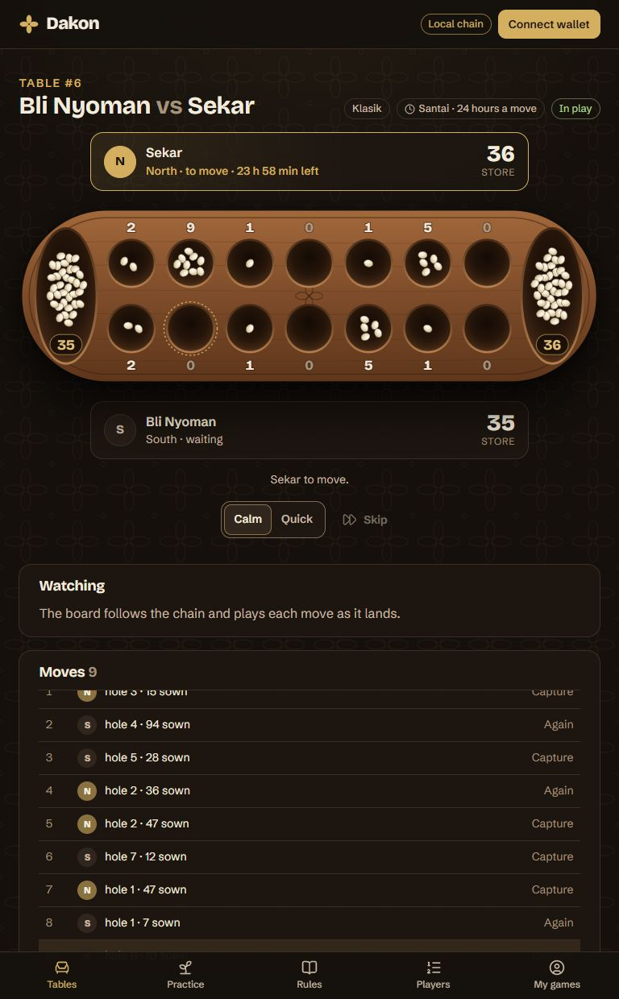 |

## Layout

```
dakon/
├── contracts/   Hardhat project: Dakon.sol, tests, deploy and seed scripts
├── web/         Vite + React + TypeScript + viem front end
│   └── src/engine/   the same rules in TypeScript (animation, practice, replay)
└── docs/        Screenshots used in this README
```

The rules exist twice: in `contracts/contracts/Dakon.sol`, which referees, and in `web/src/engine/rules.ts`, which draws. A differential test plays 200 random games through both and requires identical boards after every move. Change one, change the other.

## Run it locally

Requires Node 22.18 or newer (the contract tests load the TypeScript engine directly).

```bash
# 1. A local chain on port 8546 (leave it running)
cd contracts
npm install
npm run node
```

```bash
# 2. In a second terminal: deploy, then add sample tables
cd contracts
npm run deploy:local
npm run seed:local
```

```bash
# 3. In a third terminal: the web app, at http://localhost:5174
cd web
npm install
npm run dev
```

On the local chain the wallet dialog lists four "Dev wallet" accounts. They ask the Hardhat node to sign, so two browser windows with two dev wallets can play a whole game without an extension. They exist only in the dev server; production builds do not contain them. The seed script reserves table 10 for "Dev wallet · Tari".

## Checks

```bash
cd contracts && npm test          # 71 tests: rules, rejections, time limits, views, 200-game differential, gas
cd contracts && npm run test:diff # the differential test alone (DAKON_GAMES=400 for more games)
cd web && npm run typecheck       # TypeScript
cd web && npm run build           # production build into web/dist
```

## Which network the web app uses

| `VITE_CHAIN` | Network | Used by default in |
|---|---|---|
| `local` | Hardhat node, chain 31337, port 8546 | `npm run dev` |
| `testnet` | BOT Chain Testnet, chain 968 | — |
| `mainnet` | BOT Chain Mainnet, chain 677 | `npm run build` |

Contract addresses live in `web/src/config/deployments.json`; the deploy script fills in the right entry. Until an address is present for the active network, the site still offers practice against the computer and shows a "not on BOT Chain yet" notice instead of tables.

The public mainnet RPC has `eth_getLogs` switched off, so the app reads everything through view functions and polls a table every 2.5 seconds while a game is on.

## Deploy the contract

The deployer key stays on your machine.

```bash
cd contracts
cp .env.example .env      # then put the deployer key in .env as PRIVATE_KEY=0x...
npm run deploy:testnet    # BOT Chain Testnet (968) — test BOT from https://faucet.botchain.ai/basic
npm run deploy:mainnet    # BOT Chain Mainnet (677)
```

Deploying costs about 0.051 BOT at 20 gwei. Each deploy writes `contracts/deployments/<network>.json` and updates `web/src/config/deployments.json`; commit both so the site picks up the address. After changing the contract, run `npm run export-abi` so the web app uses the new ABI.

Do not deploy to mainnet before the project's group exists: the program does not count projects that were on mainnet earlier.

## Host the web app on Vercel

| Setting | Value |
|---|---|
| Root Directory | `web` |
| Framework Preset | Vite |
| Build Command | `npm run build` |
| Output Directory | `dist` |

No environment variables are needed for mainnet. Routes are hash-based (`#/table/3`), so no rewrites are required.

## What it costs to play

Measured in the test suite, at 20 gwei:

| Action | Gas | BOT |
|---|---|---|
| Deploy | 2,527,155 | 0.051 |
| Open a table (a wallet's first / later) | 226,524 / 127,895 | 0.0045 / 0.0026 |
| Sit down (a wallet's first / later) | 135,177 / 70,748 | 0.0027 / 0.0014 |
| A move (median of 5,300 moves) | 56,050 | 0.0011 |
| The longest move found in a real position (856 seeds) | 361,609 | 0.0072 |
| A move stopped by the sowing limit (worst case) | 469,994 | 0.0094 |

A Ringkas game takes about 20 moves, a Klasik game about 36. The worst possible move uses 1.3% of a BOT Chain block (35,000,000 gas). The contract holds no funds, has no payable function and no owner.
